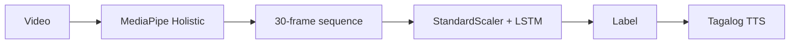

# Filipino Sign Language translator

[](https://github.com/sc-lacanlale/Codewarts/actions/workflows/ci.yml)

Real-time Filipino Sign Language (FSL) recognition. A webcam frame goes through MediaPipe Holistic, a 30-frame landmark window, and an LSTM. The predicted gloss is shown in Tagalog and can be spoken with a Filipino neural voice.

The repository is still named `Codewarts`. It is planned to be renamed `fsl-sign-language-translator`. Earlier notes called the project Senyas.

## Demo

TODO: add a short GIF of live signing, the recognized gloss, and Tagalog speech. Record it from `python -m fsl.app` and save it as `docs/demo.gif`.

## Pipeline



Each frame is a 258-float vector: 33 pose landmarks with visibility (132), the left hand (63), and the right hand (63). Missing parts are zeros. A `StandardScaler` fit on the training frames normalizes the window, then a Conv1D plus two LSTM layers scores it. With `GEMINI_API_KEY` set, Gemini can turn the gloss sequence into one Tagalog sentence. Without that key, the Tagalog glosses are joined.

The model the app loads has **15 classes**. Details, the label table, and the legacy 11-class checkpoint are in [docs/model.md](docs/model.md).

## Quick start

Tested with Python 3.12. The fifth command does not need a camera.

```bash
python3.12 -m venv .venv
source .venv/bin/activate
pip install -e ".[app]"
python scripts/download_holistic_landmarker.py
python -m fsl.app --smoke
```

On Windows, activate with `.venv\Scripts\activate` instead of `source`.

Open the webcam UI with `python -m fsl.app`. The scripted pitch mode is `python -m fsl.app --demo`. The first webcam launch downloads the Holistic task file if `scripts/download_holistic_landmarker.py` has not been run. Linux needs a display and, for the Tk window, the `python3-tk` package.

Copy `.env.example` to `.env` if you want Gemini rewriting or a different TTS voice. The app runs without either.

## Develop

```bash
pip install -e ".[app,dev]"
ruff check .
ruff format --check .
pytest
```

CI on pull requests installs the `dev` extra, runs Ruff, runs pytest, and runs `python -m fsl.app --smoke`.

## Layout

```
src/fsl/          library: landmarks, sequence shaping, LSTM, labels, TTS
apps/             Tk webcam app and the scripted demo
notebooks/        video prep and the Colab trainers
scripts/          download the Holistic task file and the weights
models/fsl15/     15-class checkpoint the app loads
models/fsl11/     earlier 11-class checkpoint
tests/
```

## Results

The shipped checkpoint's last dense layer has 15 units, and `models/fsl15/labels.npy` lists 15 glosses, in this order:

`GOOD_AFTERNOON`, `NICE_TO_MEET_YOU`, `YES`, `NO`, `THANK_YOU`, `HOW_ARE_YOU`, `ONE`, `TWO`, `THREE`, `SIX`, `SEVEN`, `CORRECT`, `WRONG`, `IM_FINE`, `UNDERSTAND`.

`model.count_params()` on `models/fsl15/model.h5` is 190,671 with Keras 3.15.1.

Those checkpoints, scalers, and label files are also on GitHub Release [model-weights-v1](https://github.com/sc-lacanlale/Codewarts/releases/tag/model-weights-v1). `python scripts/download_weights.py` fetches them when they are not already under `models/`.

TODO: held-out accuracy, per-class scores, and a confusion matrix. This repository does not include the clip set or an evaluation split, so those numbers are not reported here. Do not treat a smoke-test argmax as accuracy. `python -m fsl.app --smoke` only checks that a synthetic 30×258 window produces a 15-way softmax.

## Dataset

Training notebooks use the Kaggle set [`previlace/fsl-105`](https://www.kaggle.com/datasets/previlace/fsl-105) (`labels.csv` and `fsl_clips/<id>/*.MOV`) and keep the 15 glosses above. Clip counts are not stored in this repository. The videos themselves are not committed.

## Stack

Python, TensorFlow / Keras, scikit-learn, MediaPipe Tasks (Holistic), OpenCV, Tk, edge-tts. Gemini is optional.

## Limitations

- The vocabulary is 15 glosses, not a general FSL dictionary.
- Recognition quality on real signing has not been measured in this repo.
- The webcam path needs a local camera, a display, the Holistic `.task` file, and the system EGL library (`libegl1` on Debian or Ubuntu). MediaPipe's Holistic graph was not exercised on a live camera in CI.
- edge-tts needs a network call at speech time. gTTS and pyttsx3 are fallbacks.
- Gemini is used only when `GEMINI_API_KEY` is set.

## Roadmap

- Demo GIF.
- A held-out evaluation on the 15-gloss subset, with per-class scores.
- After this pull request is merged, drop the unused history blobs listed in [docs/model.md](docs/model.md). The shipped weights stay in the tree.

## Team and roles

- **Shanley Clarence Lacanlale** (`sc-lacanlale`) — TODO: role.
- **certainlynotnathan** (Nathaniel Joseph) — TODO: role. Commits authored as NATHANIEL JOSEPH, and the commits that use the GitHub noreply address for certainlynotnathan, are this person.
- **ryvxz** — TODO: role.

## Licence

Source code is under the MIT License. See [LICENSE](LICENSE).

Copyright (c) 2026 The Codewarts / FSL Translator contributors (Shanley Clarence Lacanlale, certainlynotnathan, ryvxz).

The dataset, recorded landmark data, and trained model weights are not under MIT. They are licensed under CC BY-NC 4.0. See [LICENSE-DATA](LICENSE-DATA) and <https://creativecommons.org/licenses/by-nc/4.0/>.
